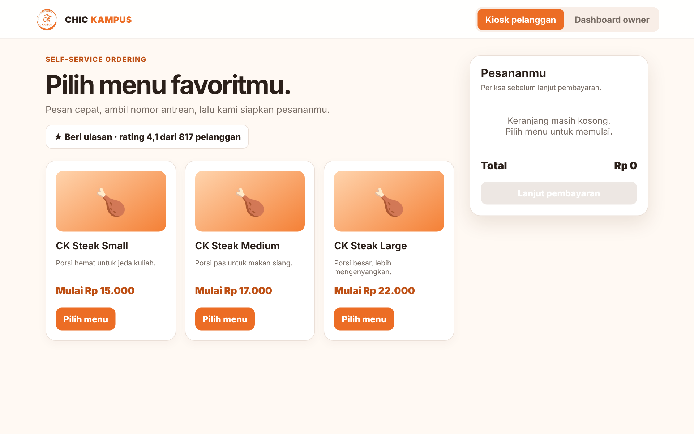
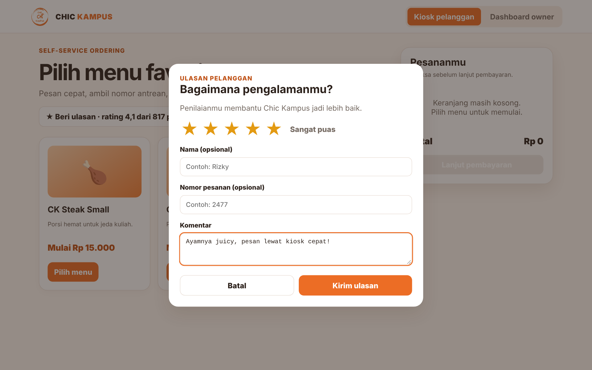
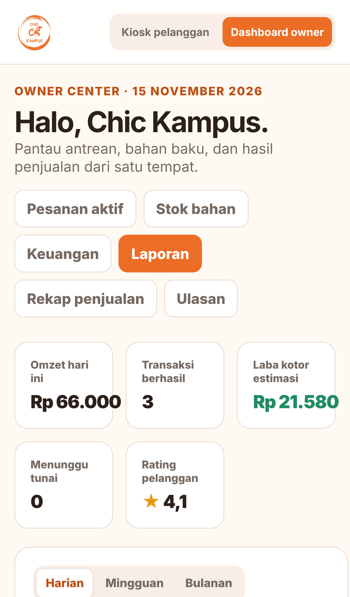
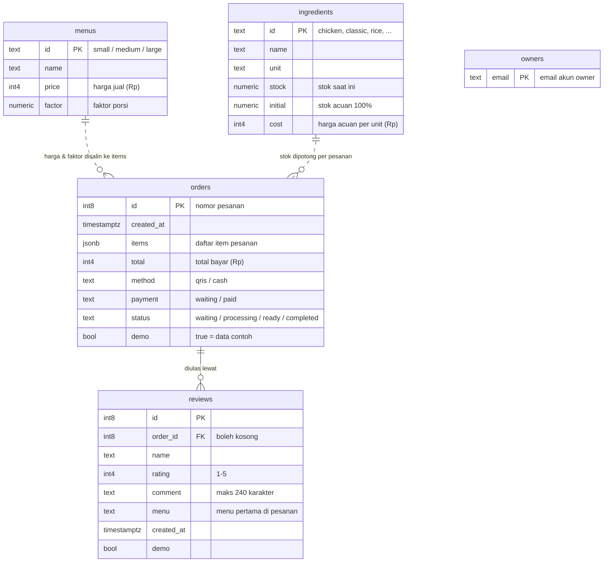
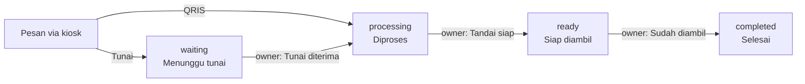

<p align="center">
  
</p>

<h1 align="center">ChicSteak App</h1>

<p align="center">
  Aplikasi kios <i>self-service</i> untuk <b>Chic Kampus</b> — pelanggan memesan sendiri,<br>
  owner memantau antrean, stok bahan, laporan penjualan, dan ulasan pelanggan dari satu tempat.
</p>

<p align="center">
  <a href="https://jundyganteng20.github.io/chicsteak-app/"><b>🔗 Buka aplikasi (demo live)</b></a>
</p>

<p align="center">
  
  
  
  
  
</p>

---


## Daftar isi

- [Fitur](#fitur)
- [Tampilan](#tampilan)
- [Cara menjalankan](#cara-menjalankan)
- [Cara pakai](#cara-pakai)
- [Menu & harga](#menu--harga)
- [Cara perhitungan](#cara-perhitungan)
- [Database online (Supabase)](#database-online-supabase)
  - [Struktur database](#struktur-database)
  - [Fungsi database (RPC)](#fungsi-database-rpc)
  - [Hak akses](#hak-akses-row-level-security)
- [Data contoh](#data-contoh)
- [Struktur proyek](#struktur-proyek)
- [Batasan](#batasan)
- [Rencana pengembangan](#rencana-pengembangan)

## Fitur

### 🧾 Kiosk pelanggan
- Pilih menu **CK Steak Small / Medium / Large**
- Pilih saus (**Classic Cheese, Magic Mushroom, Hot Lava, Black Thunder**) dan karbo (**Nasi / Kentang**)
- Keranjang dengan tambah/kurang jumlah — otomatis menolak jika stok bahan tidak cukup
- Bayar dengan **QRIS** (langsung diproses) atau **Tunai** (menunggu konfirmasi owner)
- Nomor pesanan untuk pengambilan
- **Beri ulasan** ⭐ 1–5 bintang dengan nama, nomor pesanan, dan komentar

### 📊 Dashboard owner
Dilindungi **login owner** (email + password). Pesanan baru, perubahan stok, dan ulasan muncul **realtime** tanpa perlu refresh.

| Tab | Isi |
|---|---|
| **Pesanan aktif** | Antrean pesanan, konfirmasi pembayaran tunai, ubah status *Diproses → Siap diambil → Selesai* |
| **Stok bahan** | Sisa 8 bahan baku, indikator merah saat stok ≤ 25%, tombol restok |
| **Keuangan** | Ringkasan hari ini: omzet, HPP, laba kotor, QRIS vs tunai |
| **Laporan** | Laporan **harian, mingguan, bulanan** — KPI dengan perbandingan ke periode sebelumnya, grafik omzet per jam/hari, menu terlaris, saus & karbo favorit, rincian keuangan, ulasan periode tersebut. Bisa **dicetak / disimpan PDF** |
| **Rekap penjualan** | Tabel rekap **30 hari / 12 minggu / 6 bulan** terakhir: transaksi, porsi, omzet, HPP, laba, QRIS, tunai, rating + baris total. **Unduh CSV** (siap dibuka di Excel) dan cetak |
| **Ulasan** | Rating rata-rata, % pelanggan puas, sebaran bintang, tren rating per minggu, daftar ulasan dengan filter bintang |

## Tampilan

| Kiosk pelanggan | Beri ulasan |
|---|---|
|  |  |

| Rekap penjualan | Ulasan pelanggan |
|---|---|
|  |  |

<p align="center"><br><i>Tampilan di HP</i></p>

## Cara menjalankan

Frontend cukup HTML, CSS, dan JavaScript (tanpa build). Data disimpan online di **Supabase**.

**Opsi 1 — Online**
Buka 👉 https://jundyganteng20.github.io/chicsteak-app/

**Opsi 2 — Di komputer sendiri**
```bash
git clone https://github.com/JUNDYGANTENG20/chicsteak-app.git
```
Lalu buka `index.html` di browser, atau di VS Code klik kanan `index.html` → **Open with Live Server** (port 5501). Perlu koneksi internet karena data diambil dari Supabase.

## Cara pakai

1. **Pelanggan** — di tab *Kiosk pelanggan*, pilih menu → atur saus & karbo → *Tambah ke pesanan* → *Lanjut pembayaran* → pilih QRIS/Tunai → catat nomor pesanan.
2. **Owner** — buka *Dashboard owner* lalu **login** dengan akun owner:
   - *Pesanan aktif*: klik **Tunai diterima** untuk pesanan tunai, lalu **Tandai siap** → **Sudah diambil**.
   - *Stok bahan*: isi jumlah lalu **Tambah** untuk restok.
   - *Laporan*: pilih Harian/Mingguan/Bulanan, geser periode dengan tombol **‹ ›**, klik batang grafik untuk melihat laporan hari itu.
   - *Rekap penjualan*: pilih jenis rekap, klik baris untuk membuka laporannya, **Unduh CSV** untuk Excel.
   - *Ulasan*: klik baris bintang atau chip filter untuk menyaring ulasan.

## Menu & harga

| Menu | Harga | Faktor porsi |
|---|---:|---:|
| CK Steak Small | Rp 15.000 | 1,0× |
| CK Steak Medium | Rp 17.000 | 1,2× |
| CK Steak Large | Rp 22.000 | 1,5× |

Setiap porsi memakai: ayam, saus, dan karbo × faktor porsi, ditambah 1 kemasan.

| Bahan | Harga acuan |
|---|---:|
| Ayam | Rp 6.500 / porsi dasar |
| Saus Classic Cheese / Hot Lava | Rp 1.000 / takaran |
| Saus Magic Mushroom / Black Thunder | Rp 1.100 / takaran |
| Nasi | Rp 1.500 / porsi |
| Kentang | Rp 2.500 / porsi |
| Kemasan | Rp 700 / pcs |

> Harga bahan adalah asumsi demo — ubah di objek `seed.ingredients` pada `app.js` sesuai pembelian aktual.

## Cara perhitungan

- **Omzet** = total pesanan yang **sudah dibayar** (pesanan tunai yang belum dikonfirmasi tidak dihitung).
- **HPP (estimasi)** = Σ (harga bahan × takaran resep × jumlah porsi).
- **Laba kotor** = Omzet − HPP. **Margin** = Laba kotor ÷ Omzet.
- **Perbandingan periode**: periode yang sedang berjalan dibandingkan dengan rentang waktu yang setara di periode sebelumnya (mis. 1–15 Nov dibanding 1–15 Okt), agar persentasenya adil.
- **Minggu** dihitung Senin–Minggu.
- **Pelanggan puas** = persentase ulasan bintang 4–5.

## Database online (Supabase)

Semua data — pesanan, stok bahan, ulasan — tersimpan di database **Supabase** (PostgreSQL), sehingga kiosk di satu perangkat dan dashboard owner di perangkat lain selalu sinkron.

### Struktur database



> Garis putus-putus = hubungan logis (tanpa *foreign key*): harga menu disalin ke `orders.items` saat pesanan dibuat, jadi riwayat penjualan tidak berubah walaupun harga menu diganti nanti.

#### `menus` — daftar menu
| Kolom | Tipe | Keterangan |
|---|---|---|
| `id` 🔑 | text | Kode menu: `small`, `medium`, `large` |
| `name` | text | Nama tampilan, mis. *CK Steak Medium* |
| `price` | int4 | Harga jual dalam rupiah |
| `factor` | numeric | Pengali porsi bahan (Small 1,0 · Medium 1,2 · Large 1,5) |

#### `ingredients` — stok bahan baku
| Kolom | Tipe | Keterangan |
|---|---|---|
| `id` 🔑 | text | `chicken`, `classic`, `mushroom`, `lava`, `thunder`, `rice`, `fries`, `packaging` |
| `name` | text | Nama bahan |
| `unit` | text | Satuan (porsi, takaran, pcs) |
| `stock` | numeric | Stok saat ini — berkurang otomatis setiap pesanan dibayar |
| `initial` | numeric | Stok acuan untuk bar persentase; naik saat restok melebihi nilai ini |
| `cost` | int4 | Harga acuan per satuan, dipakai menghitung HPP |

#### `orders` — pesanan
| Kolom | Tipe | Keterangan |
|---|---|---|
| `id` 🔑 | int8 | Nomor pesanan (otomatis) yang ditunjukkan ke pelanggan |
| `created_at` | timestamptz | Waktu pesanan dibuat |
| `items` | jsonb | Daftar item (lihat contoh di bawah) |
| `total` | int4 | Total bayar, dihitung server dari `menus.price × qty` |
| `method` | text | `qris` atau `cash` |
| `payment` | text | `waiting` (tunai belum dibayar) atau `paid` |
| `status` | text | Alur pesanan (lihat di bawah) |
| `demo` | bool | `true` untuk data contoh |

Contoh isi `items`:
```json
[
  { "id": "medium", "name": "CK Steak Medium", "price": 17000, "factor": 1.2,
    "sauce": "lava", "carb": "rice", "qty": 2, "key": "medium-lava-rice" }
]
```
`sauce`: `classic` · `mushroom` · `lava` · `thunder` — `carb`: `rice` · `fries`

Alur `status`:

Stok bahan dipotong saat pesanan QRIS dibuat, atau saat owner mengonfirmasi pembayaran tunai.

#### `reviews` — ulasan pelanggan
| Kolom | Tipe | Keterangan |
|---|---|---|
| `id` 🔑 | int8 | Nomor ulasan (otomatis) |
| `order_id` 🔗 | int8 | Nomor pesanan yang diulas → `orders.id` (boleh kosong; jika pesanan dihapus menjadi kosong) |
| `name` | text | Nama pelanggan, default *Pelanggan* (maks 30 karakter) |
| `rating` | int4 | Bintang 1–5 |
| `comment` | text | Komentar (maks 240 karakter) |
| `menu` | text | Menu pertama dari pesanan terkait, untuk ditampilkan di kartu ulasan |
| `created_at` | timestamptz | Waktu ulasan dikirim |
| `demo` | bool | `true` untuk data contoh |

#### `owners` — akun owner
| Kolom | Tipe | Keterangan |
|---|---|---|
| `email` 🔑 | text | Email akun Supabase Auth yang boleh membuka Dashboard owner. Tabel ini tidak bisa dibaca dari aplikasi. |

### Fungsi database (RPC)

Aplikasi tidak menulis langsung ke tabel; semua perubahan lewat fungsi berikut sehingga aturan bisnis selalu dijalankan di server.

| Fungsi | Dipakai oleh | Kegunaan |
|---|---|---|
| `place_order(items, method)` | Pelanggan | Validasi menu/saus/karbo/qty, hitung total dari `menus`, cek & potong stok, simpan pesanan |
| `submit_review(name, rating, comment, order_id)` | Pelanggan | Simpan ulasan (rating 1–5, teks dibatasi) |
| `rating_summary()` | Pelanggan | Rata-rata rating & jumlah ulasan untuk tombol di kiosk |
| `is_owner()` | Owner | Cek apakah email yang login terdaftar di `owners` |
| `confirm_cash(id)` | Owner | Konfirmasi pembayaran tunai + potong stok |
| `set_order_status(id, status)` | Owner | Ubah status ke `ready` / `completed` |
| `restock(id, qty)` | Owner | Tambah stok bahan |
| `reset_demo()` | Owner | Hapus & buat ulang data contoh |
| `seed_demo(days)` | Internal | Generator data contoh (tidak bisa dipanggil dari aplikasi) |

### Hak akses (Row Level Security)

| Tabel | Pengunjung (tanpa login) | Owner (login) |
|---|---|---|
| `menus` | Baca | Baca |
| `ingredients` | Baca | Baca, restok lewat RPC |
| `orders` | Hanya membuat pesanan lewat RPC | Baca semua, ubah lewat RPC |
| `reviews` | Hanya mengirim ulasan lewat RPC | Baca semua |
| `owners` | – | – (hanya lewat Supabase Dashboard) |

### Keamanan
- Row Level Security aktif di semua tabel. Tanpa login, browser hanya bisa membaca menu & stok.
- Pelanggan membuat pesanan & ulasan lewat fungsi `place_order` dan `submit_review`. Harga dihitung ulang di server dari tabel `menus`, jadi total tidak bisa dimanipulasi dari browser, dan stok dicek/dipotong secara atomik.
- Data penjualan, konfirmasi tunai, ubah status, dan restok hanya untuk akun yang emailnya ada di tabel `owners`.
- Kunci di `db.js` adalah *publishable key* — memang aman ditaruh di frontend.

### Menambah akun owner
1. Supabase Dashboard → **Authentication → Users → Add user → Create new user**, isi email & password, centang *Auto Confirm User*.
2. **SQL Editor** → jalankan:
   ```sql
   insert into public.owners (email) values ('email-owner@contoh.com');
   ```

### Membuat ulang database

Jalankan isi [`supabase/schema.sql`](supabase/schema.sql) di SQL Editor project Supabase baru, lalu ganti `SUPABASE_URL` dan `SUPABASE_KEY` di `db.js`.

## Data contoh

Database sudah berisi **riwayat penjualan contoh 120 hari terakhir** dan ulasan dengan nama & komentar fiktif, supaya laporan dan rekap langsung terisi. Data contoh dibuat oleh fungsi `seed_demo()` dan dirancang **selalu tumbuh**: omzet, transaksi, porsi, rata-rata per transaksi, dan laba kotor tidak pernah turun dibanding hari/minggu/bulan sebelumnya.

- Data contoh ditandai `demo = true`; pesanan & ulasan asli tidak ikut terhapus.
- Tombol **Acak ulang data contoh** ada di tab *Rekap penjualan* (khusus owner).
- Menghapus semua data contoh (SQL Editor):
  ```sql
  delete from public.reviews where demo; delete from public.orders where demo;
  ```

## Struktur proyek

```
chicsteak-app/
├── index.html          # Kerangka halaman, memuat semua script
├── styles.css          # Tampilan (responsif + gaya cetak)
├── app.js              # Inti aplikasi: menu, keranjang, kiosk, dashboard owner, ulasan
├── db.js               # Koneksi Supabase: muat data, realtime, login owner
├── reports.js          # Tab Laporan, Rekap penjualan (CSV) dan Ulasan
├── periods.js          # Pembantu tanggal & periode (harian/mingguan/bulanan)
├── supabase/
│   └── schema.sql      # Skema database, keamanan (RLS) & fungsi RPC
├── assets/
│   └── logo-chic-kampus.jpg
└── docs/
    └── screenshots/    # Gambar untuk README
```

Urutan script di `index.html` penting: `supabase-js` → `periods.js` → `reports.js` → `db.js` → `app.js`.

## Batasan

- Perlu koneksi internet.
- Pembayaran QRIS masih **simulasi** — belum terhubung ke payment gateway.
- Project Supabase gratis akan *di-pause* otomatis bila tidak dipakai ±7 hari; aktifkan lagi dari Supabase Dashboard.

## Rencana pengembangan

- [x] Database online (Supabase) agar kiosk & dashboard owner tersinkron antar perangkat
- [x] Login untuk owner
- [ ] Integrasi QRIS sungguhan
- [ ] Balasan owner untuk ulasan pelanggan
- [ ] Menu minuman & add-on
- [ ] Notifikasi stok menipis

---

<p align="center">Dibuat untuk <b>Chic Kampus</b> 🍗</p>
