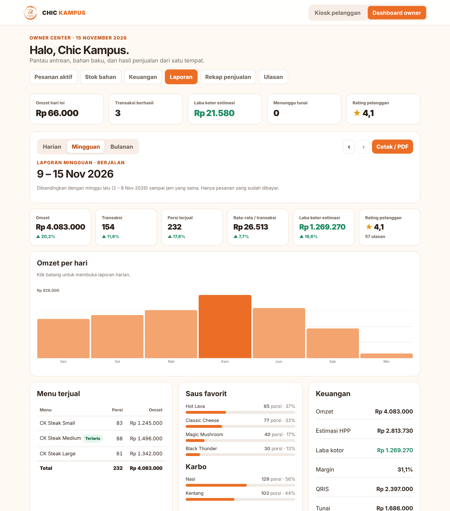
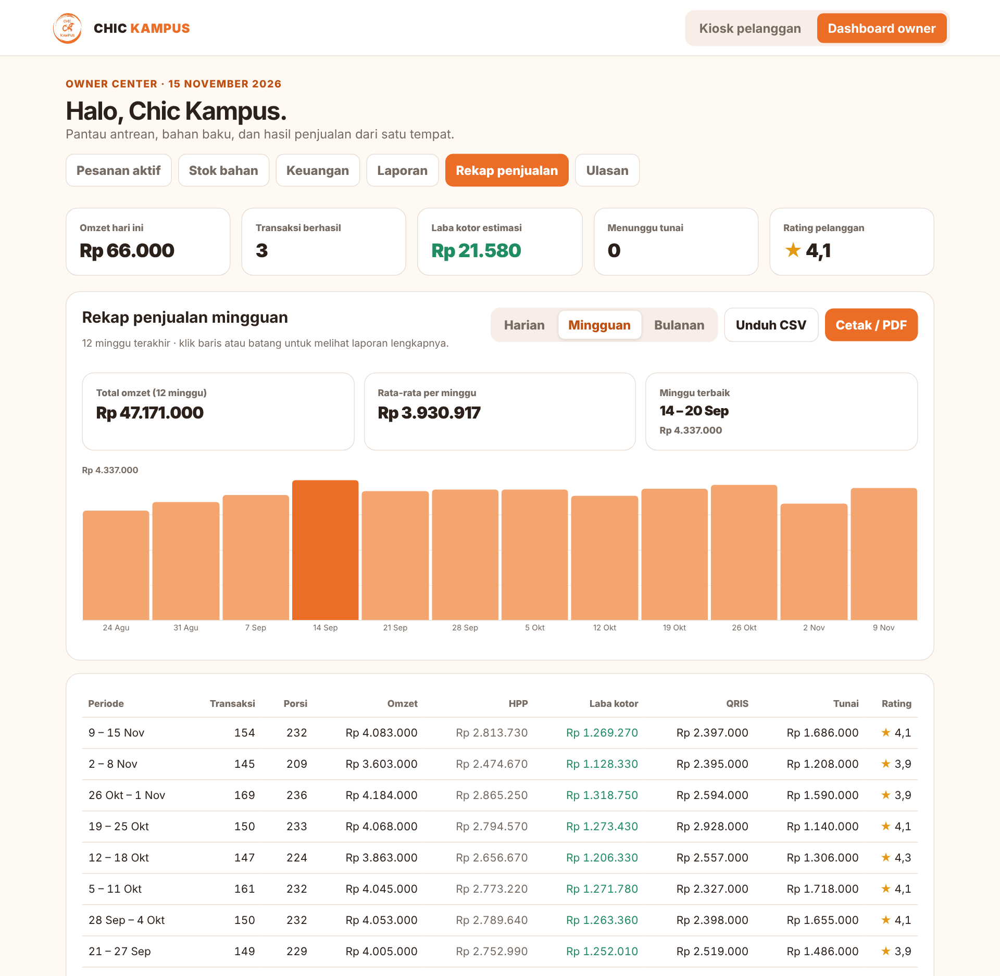
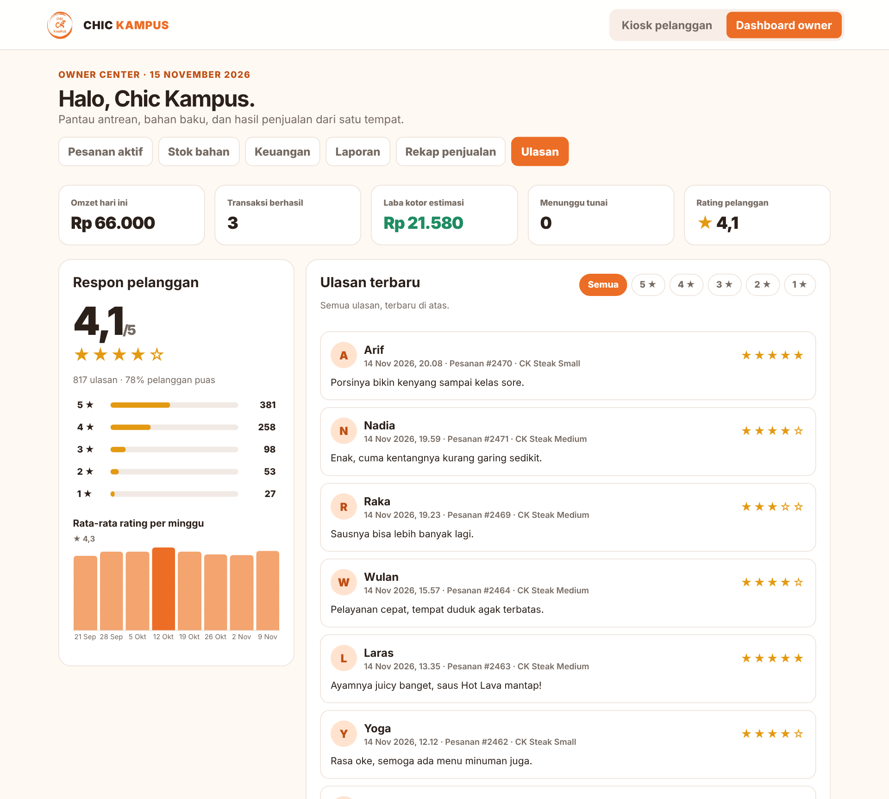

<p align="center">
  
</p>

<h1 align="center">ChicSteak App</h1>

<p align="center">
  Aplikasi kios <i>self-service</i> untuk <b>Chic Kampus</b> — pelanggan memesan sendiri,<br>
  owner memantau antrean, stok bahan, laporan penjualan, dan ulasan pelanggan dari satu tempat.
</p>

<p align="center">
  <a href="https://jundyganteng20.github.io/chicsteak-app/"><b>🔗 Buka aplikasi (demo live)</b></a>
</p>

<p align="center">
  
  
  
  
</p>

---



## Daftar isi

- [Fitur](#fitur)
- [Tampilan](#tampilan)
- [Cara menjalankan](#cara-menjalankan)
- [Cara pakai](#cara-pakai)
- [Menu & harga](#menu--harga)
- [Cara perhitungan](#cara-perhitungan)
- [Data contoh](#data-contoh)
- [Struktur proyek](#struktur-proyek)
- [Batasan](#batasan)
- [Rencana pengembangan](#rencana-pengembangan)

## Fitur

### 🧾 Kiosk pelanggan
- Pilih menu **CK Steak Small / Medium / Large**
- Pilih saus (**Classic Cheese, Magic Mushroom, Hot Lava, Black Thunder**) dan karbo (**Nasi / Kentang**)
- Keranjang dengan tambah/kurang jumlah — otomatis menolak jika stok bahan tidak cukup
- Bayar dengan **QRIS** (langsung diproses) atau **Tunai** (menunggu konfirmasi owner)
- Nomor pesanan untuk pengambilan
- **Beri ulasan** ⭐ 1–5 bintang dengan nama, nomor pesanan, dan komentar

### 📊 Dashboard owner
| Tab | Isi |
|---|---|
| **Pesanan aktif** | Antrean pesanan, konfirmasi pembayaran tunai, ubah status *Diproses → Siap diambil → Selesai* |
| **Stok bahan** | Sisa 8 bahan baku, indikator merah saat stok ≤ 25%, tombol restok |
| **Keuangan** | Ringkasan hari ini: omzet, HPP, laba kotor, QRIS vs tunai |
| **Laporan** | Laporan **harian, mingguan, bulanan** — KPI dengan perbandingan ke periode sebelumnya, grafik omzet per jam/hari, menu terlaris, saus & karbo favorit, rincian keuangan, ulasan periode tersebut. Bisa **dicetak / disimpan PDF** |
| **Rekap penjualan** | Tabel rekap **30 hari / 12 minggu / 6 bulan** terakhir: transaksi, porsi, omzet, HPP, laba, QRIS, tunai, rating + baris total. **Unduh CSV** (siap dibuka di Excel) dan cetak |
| **Ulasan** | Rating rata-rata, % pelanggan puas, sebaran bintang, tren rating per minggu, daftar ulasan dengan filter bintang |

## Tampilan

| Kiosk pelanggan | Beri ulasan |
|---|---|
|  |  |

| Rekap penjualan | Ulasan pelanggan |
|---|---|
|  |  |

<p align="center"><br><i>Tampilan di HP</i></p>

## Cara menjalankan

Aplikasi ini **tanpa backend dan tanpa instalasi** — cukup HTML, CSS, dan JavaScript.

**Opsi 1 — Online**
Buka 👉 https://jundyganteng20.github.io/chicsteak-app/

**Opsi 2 — Di komputer sendiri**
```bash
git clone https://github.com/JUNDYGANTENG20/chicsteak-app.git
```
Lalu buka `index.html` di browser, atau di VS Code klik kanan `index.html` → **Open with Live Server** (port 5501).

## Cara pakai

1. **Pelanggan** — di tab *Kiosk pelanggan*, pilih menu → atur saus & karbo → *Tambah ke pesanan* → *Lanjut pembayaran* → pilih QRIS/Tunai → catat nomor pesanan.
2. **Owner** — buka *Dashboard owner*:
   - *Pesanan aktif*: klik **Tunai diterima** untuk pesanan tunai, lalu **Tandai siap** → **Sudah diambil**.
   - *Stok bahan*: isi jumlah lalu **Tambah** untuk restok.
   - *Laporan*: pilih Harian/Mingguan/Bulanan, geser periode dengan tombol **‹ ›**, klik batang grafik untuk melihat laporan hari itu.
   - *Rekap penjualan*: pilih jenis rekap, klik baris untuk membuka laporannya, **Unduh CSV** untuk Excel.
   - *Ulasan*: klik baris bintang atau chip filter untuk menyaring ulasan.

## Menu & harga

| Menu | Harga | Faktor porsi |
|---|---:|---:|
| CK Steak Small | Rp 15.000 | 1,0× |
| CK Steak Medium | Rp 17.000 | 1,2× |
| CK Steak Large | Rp 22.000 | 1,5× |

Setiap porsi memakai: ayam, saus, dan karbo × faktor porsi, ditambah 1 kemasan.

| Bahan | Harga acuan |
|---|---:|
| Ayam | Rp 6.500 / porsi dasar |
| Saus Classic Cheese / Hot Lava | Rp 1.000 / takaran |
| Saus Magic Mushroom / Black Thunder | Rp 1.100 / takaran |
| Nasi | Rp 1.500 / porsi |
| Kentang | Rp 2.500 / porsi |
| Kemasan | Rp 700 / pcs |

> Harga bahan adalah asumsi demo — ubah di objek `seed.ingredients` pada `app.js` sesuai pembelian aktual.

## Cara perhitungan

- **Omzet** = total pesanan yang **sudah dibayar** (pesanan tunai yang belum dikonfirmasi tidak dihitung).
- **HPP (estimasi)** = Σ (harga bahan × takaran resep × jumlah porsi).
- **Laba kotor** = Omzet − HPP. **Margin** = Laba kotor ÷ Omzet.
- **Perbandingan periode**: periode yang sedang berjalan dibandingkan dengan rentang waktu yang setara di periode sebelumnya (mis. 1–15 Nov dibanding 1–15 Okt), agar persentasenya adil.
- **Minggu** dihitung Senin–Minggu.
- **Pelanggan puas** = persentase ulasan bintang 4–5.

## Data contoh

Saat pertama dibuka, aplikasi otomatis membuat **riwayat penjualan acak 120 hari terakhir** (± 2.500 pesanan) dan **± 800 ulasan** dengan nama & komentar fiktif, supaya laporan dan rekap langsung berisi. Polanya dibuat realistis untuk kantin kampus: ramai di jam makan siang dan sore, sepi di akhir pekan, dan sedikit meningkat dari waktu ke waktu.

- Data contoh ditandai `demo: true`; pesanan asli tidak ikut terhapus.
- Tombol **Acak ulang data contoh** ada di tab *Rekap penjualan*.
- Untuk mengosongkan semua data, hapus `localStorage` dengan kunci `chic-kampus-state` (DevTools → Application → Local Storage).

## Struktur proyek

```
chicsteak-app/
├── index.html          # Kerangka halaman, memuat semua script
├── styles.css          # Tampilan (responsif + gaya cetak)
├── app.js              # Inti aplikasi: menu, keranjang, pesanan, stok, keuangan, kiosk, ulasan
├── reports.js          # Tab Laporan, Rekap penjualan (CSV) dan Ulasan
├── demo-data.js        # Pembantu tanggal/periode + generator data contoh acak
├── assets/
│   └── logo-chic-kampus.jpg
└── docs/
    └── screenshots/    # Gambar untuk README
```

Urutan script di `index.html` penting: `demo-data.js` → `reports.js` → `app.js`.

## Batasan

- **Data tersimpan di browser masing-masing** (`localStorage`). Pesanan dari satu perangkat tidak terlihat di perangkat lain, dan data hilang jika data browser dihapus.
- Pembayaran QRIS masih **simulasi** — belum terhubung ke payment gateway.
- Belum ada login, jadi siapa pun yang membuka halaman bisa masuk ke Dashboard owner.

## Rencana pengembangan

- [ ] Database online (mis. Supabase/Firebase) agar kiosk & dashboard owner tersinkron antar perangkat
- [ ] Login untuk owner
- [ ] Integrasi QRIS sungguhan
- [ ] Balasan owner untuk ulasan pelanggan
- [ ] Menu minuman & add-on
- [ ] Notifikasi stok menipis

---

<p align="center">Dibuat untuk <b>Chic Kampus</b> 🍗</p>
